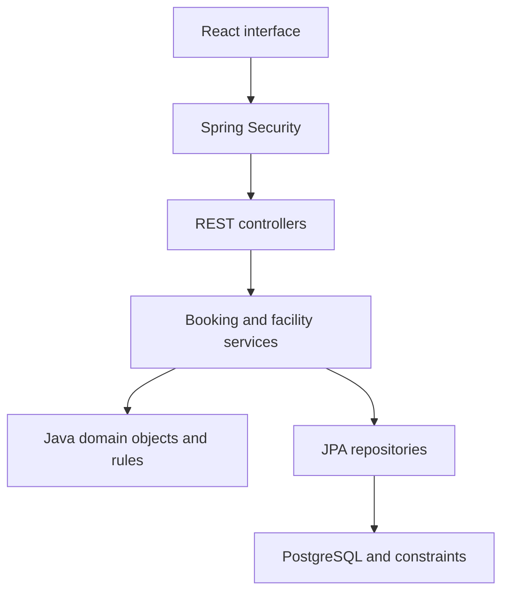

# Architecture and Java OOP

React renders the interface. Its `/api` requests reach Spring Boot, which applies authentication, permissions, validation and booking rules. Java repositories persist records in PostgreSQL. Flyway applies versioned SQL migrations at startup.

## OOP applied to this project

| Concept | Code and purpose |
| --- | --- |
| Classes and objects | `CampusUser`, `Facility`, `FacilitySlot`, `Booking` represent business objects |
| Encapsulation | Fields are private. `Booking.cancel(now)` guards changes with the cancellation rule |
| Abstraction | `VerificationSender` hides mail delivery; JPA repository interfaces hide persistence details |
| Inheritance | Entities inherit their generated ID from `BaseEntity`; an `ADMIN` role is not a separate user subclass |
| Polymorphism | `FutureSlotRule` and `AvailabilityRule` implement `BookingRule`; local and SMTP senders implement `VerificationSender` |
| Composition/associations | A booking references its student and slot; a slot references its facility |
| Dependency injection | Constructors declare dependencies, supplied by Spring; injected `Clock` makes boundary times testable |

## Data model

| Table | Relationships / important fields |
| --- | --- |
| `campus_user` | Unique normalized email, password hash, role, verification flag |
| `verification_token` | User, SHA-256 token hash, expiration; consumed after verification |
| `facility` | Type, name, location, capacity and active flag |
| `facility_slot` | Facility, start/end timestamps, blocked flag; one row per one-hour slot |
| `booking` | Student, slot, Sri Lanka date, stored state and creation timestamp |

Never expose entities directly as API responses: view records omit password hashes and tokens.

## Concurrency and time

Booking creation locks the user, then facility, then slot in a transaction. This serializes competing requests across application instances. Partial unique indexes enforce one confirmed booking per slot and one confirmed booking per student/date even if application checks are bypassed. Cancelled records do not participate in either index.

After waiting for locks, mutable state is refreshed before validation. Cancellation and administrative changes use a compatible lock order. The database checks that slots are exactly one hour and start on whole hours in the campus timezone.

Store instants as PostgreSQL `TIMESTAMPTZ`; derive the quota date using `Asia/Colombo`, never the browser timezone or database server default. Treat time ranges as `[start, end)`. The status is `COMPLETED` at exactly the end instant. Completion retains the stored confirmed record so a second booking that day cannot be made after using the first hour.

## Authentication

Registration creates a disabled student account and a random 256-bit token, storing only its hash. A single-use link enables the account. Session login uses Spring Security's standard filter, session fixation protection, an HttpOnly cookie and CSRF protection. React obtains a fresh token from `/api/auth/csrf` before each mutation, including login, verification and logout.

Development uses a Vite proxy to keep frontend requests on the same origin. Production should similarly route `/api` through one HTTPS origin. The `prod` startup guard rejects the local profile, non-HTTPS frontend URLs, insecure cookies or a missing SMTP host. Edge rate limits and verified SMTP delivery remain pre-deployment gates.

## Research sources

- [Spring Boot 4.0 system requirements](https://docs.spring.io/spring-boot/4.0/system-requirements.html): Java 17 baseline.
- [Spring Data JPA guide](https://spring.io/guides/gs/accessing-data-jpa/): entity/repository separation.
- [Spring Security CSRF guidance](https://docs.spring.io/spring-security/reference/servlet/exploits/csrf.html): session CSRF endpoint pattern and login/logout token lifecycle.
- [PostgreSQL partial indexes](https://www.postgresql.org/docs/current/indexes-partial.html): conditional uniqueness for non-cancelled bookings.
- [React with Vite](https://react.dev/learn/build-a-react-app-from-scratch): client-side tooling for a separate API backend.

The technology and concurrency design above are project decisions informed by these sources.
